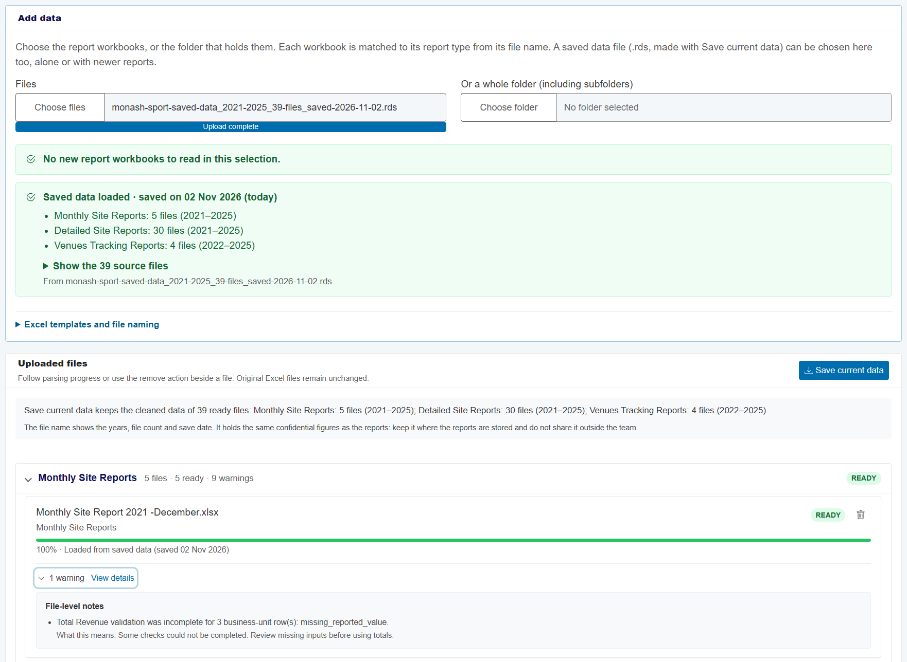
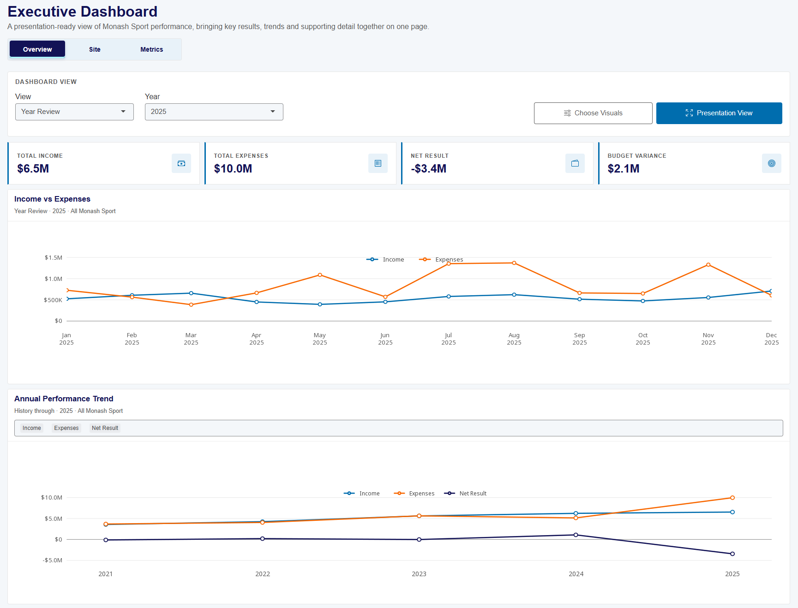
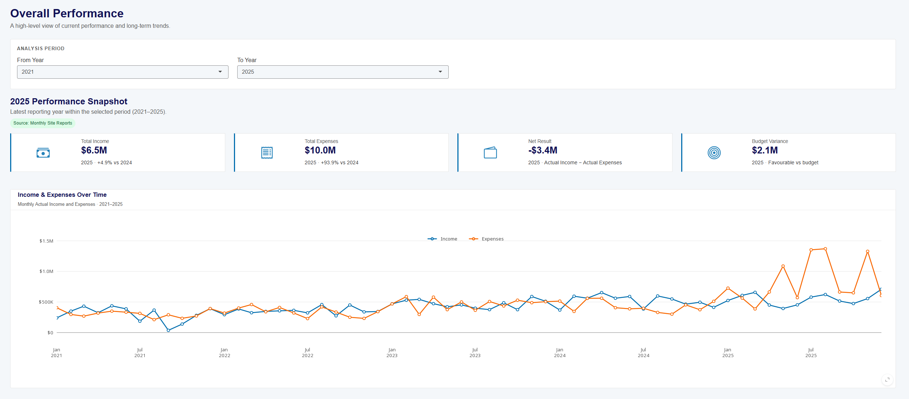
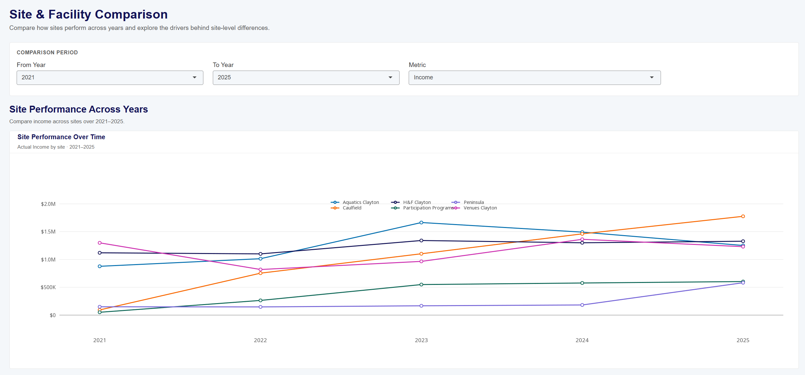
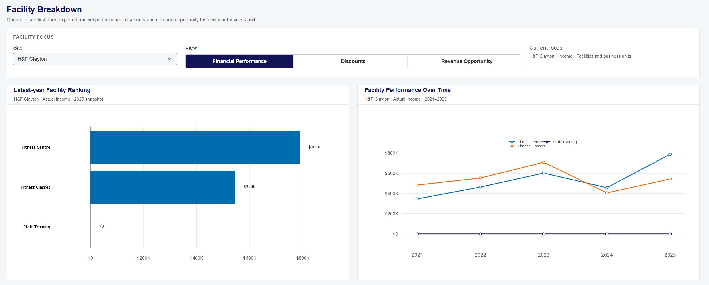
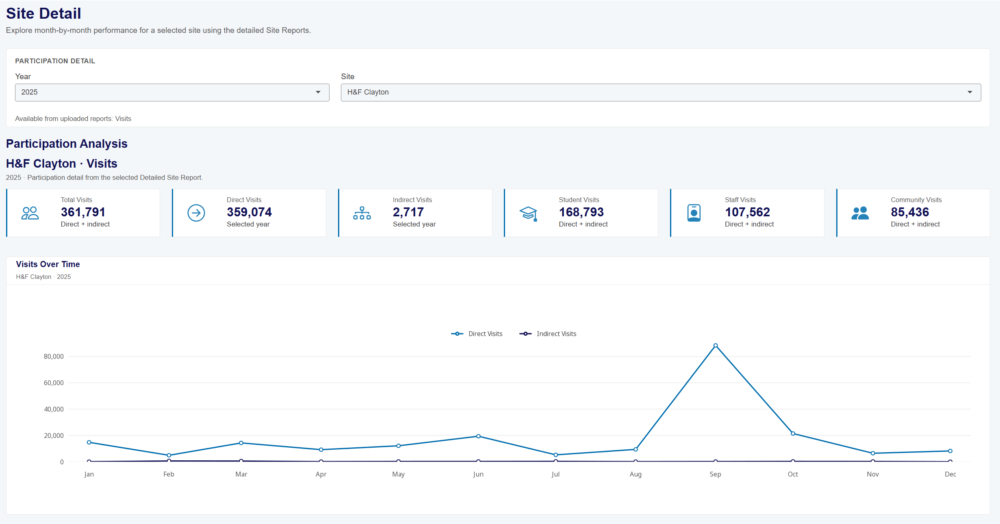
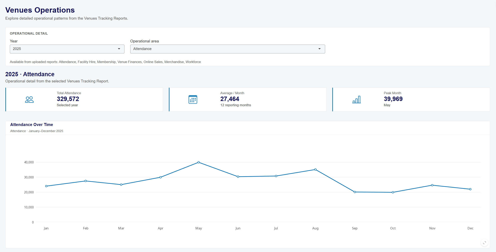
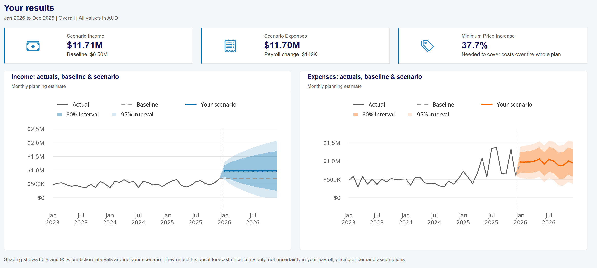
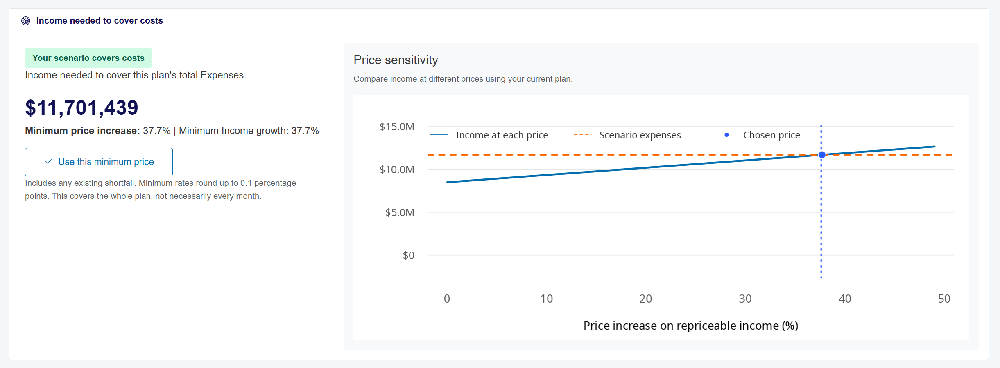

<!-- All screenshots in this guide use the synthetic sample workbooks
(data/sample/), never the real reports. Images: docs/images/user_guide/.
Render from the project root:  quarto render docs/user_guide.qmd -->

This guide is for Monash Sport staff who want to use the dashboard. You do not
need to know anything about coding. If you can open a website, find a folder on
your computer and open an Excel file, you can use the dashboard.

**Dashboard address:**
<https://vicky-fengz.github.io/ETC5543-Monash-Sports/>

*The screenshots in this guide use made-up sample data, so the figures in them
are not Monash Sport's real results.*

## 1. What the dashboard does {#what}

The dashboard reads the Excel reports Monash Sport already prepares and shows
them as charts and summary figures in one place. You can use it to:

- see how Monash Sport is performing this month and this year;
- compare sites, facilities and years side by side;
- look at visits, memberships, enrolments and Venues activity in detail;
- prepare a one-page summary to show in a meeting;
- estimate the next few months' income and expenses, and see how a pay rise or
  a price change would affect them.

**What it does not do.** It does not change your Excel files, it does not
connect to the finance or booking systems, and it does not replace the monthly
reports. You still prepare the reports in Excel as usual; the dashboard only
reads them.

**Your data stays on your computer.** The dashboard runs inside your web
browser. When you add your reports, they are read on your own computer and are
never sent anywhere else. See [section 10](#privacy).


## 2. Quick start {#quick-start}

If you just want to see the dashboard working, follow these five steps.

1. Open **Google Chrome** or **Microsoft Edge** and go to the
   [dashboard address](https://vicky-fengz.github.io/ETC5543-Monash-Sports/).
   Wait about 20 seconds while it loads.
2. Click **Data** in the menu at the top of the page.
3. In the **Add data** box, click **Choose folder** and select the folder that
   holds the dashboard reports.
4. Wait until every file in the **Uploaded files** list says **READY**. This
   takes about 3 minutes the first time.
5. Click **Executive Dashboard** at the top of the page to see the summary.

Before you close the page, follow [section 4.2](#save)
to save your data. Next time, it will load in a few seconds instead of
3 minutes.


## 3. Before you start {#before}

### What you need

- A computer with **Google Chrome** or **Microsoft Edge**. Other browsers may
  work, but these two have been tested.
- Access to the shared folder where the dashboard reports are kept.
- About 5 minutes the first time you load the reports.

You do not need to install anything.

### Where to keep the reports

Keep one shared folder for the dashboard reports, for example on the team's
OneDrive, SharePoint or Teams site, with access limited to Monash Sport staff.
Inside it, use one folder for each type of report:

```text
Monash Sport Dashboard Reports/
  Monthly Site Report/
    Monthly Site Report 2025 -December.xlsx
  Business Unit Templates that feed master reports/
    2025/
      Aquatics Site Report 2025.xlsx
      Caulfield Site Report 2025.xlsx
      Health & Fitness Site Report 2025.xlsx
      Participation Program Report 2025.xlsx
      Peninsula Site Report 2025.xlsx
      Venues Site Report 2025.xlsx
  Business Unit Tracking Reports/
    2025 Venues Tracking Report.xlsx
```

### How to name the files

The dashboard works out what each file is from its **file name**, so the names
matter. Please follow these rules:

| Rule | Good example | Problem example |
|---|---|---|
| Put **one** year in each file name | `Aquatics Site Report 2025.xlsx` | `Aquatics Site Report 2025 (copy of 2024).xlsx` |
| Monthly reports start with `Monthly Site Report` | `Monthly Site Report 2026 - March.xlsx` | `March 2026 monthly.xlsx` |
| Business unit reports say `Site Report` or `Program Report` and start with the unit's name | `Participation Program Report 2026.xlsx` | `PP 2026.xlsx` |
| Venues reports say `Venues Tracking Report` | `2026 Venues Tracking Report.xlsx` | `Venues 2026.xlsx` |
| Keep **one** Monthly Site Report and **one** Venues Tracking Report for each year | Replace the year's file with the latest version | Keeping `... -November.xlsx` and `... -December.xlsx` side by side |

Keep drafts, old copies and other documents **outside** this folder. If two
files cover the same year, the dashboard uses only one of them (see
[section 9](#problems)).

Also keep the worksheet names, headings and layout of the reports as they are.
The dashboard finds the figures by looking for the usual headings, such as
`INCOME`, `EXPENSES` and the month names.


## 4. Loading your reports {#loading}

### 4.1 The first time

1. Open the dashboard and click **Data** in the top menu. Stay on the
   **Upload & Manage** tab.
2. In the **Add data** box, click **Choose folder** and select the
   *Monash Sport Dashboard Reports* folder. Folders inside it are included
   automatically. (You can also click **Choose files** and select individual
   Excel files.)
3. Your browser may ask whether you want to upload the files to the site.
   Click **Upload**. This only lets the dashboard read them inside your
   browser; nothing is sent over the internet.
4. Wait while the files are read. A blue message shows the progress, and the
   buttons are paused until it finishes. **Keep the page open** during this
   time. Reading a full set of reports takes about 3 minutes.
5. Read the short summary under the buttons. It says how many files were
   recognised for each type of report.
6. Look at the **Uploaded files** list. The files are grouped by type of
   report; click a group's name to open or close it. Each file has a status:

   | Status | What it means |
   |---|---|
   | **QUEUED** | Waiting to be read |
   | **PARSING** | Being read now |
   | **READY** | Read successfully. Its figures are in the dashboard |
   | **FAILED** | Not used. A message explains why (see [section 9](#problems)) |

7. Some **READY** files show a number of warnings. Click **View details**
   under the file to read them. A warning does not stop the file from being
   used and does not change any figure; it tells you something in the report
   that you may want to check, such as a missing month.



When the files are ready, the top-right corner of the page shows which years
are loaded. You can now use any page in the menu.

**Close the reports in Excel before you add them.** A file that is open in
Excel may not be read correctly.

### 4.2 Save your data for next time {#save}

Reading all the reports takes a few minutes. You can save the result so that
next time it loads in about 3 seconds.

1. When every file shows **READY**, click **Save current data** at the top of
   the **Uploaded files** box.
2. Your browser downloads one file with a name like
   `monash-sport-saved-data_2021-2025_39-files_saved-2026-10-31.rds`.
   The name tells you which years it covers, how many reports it holds and
   when it was saved. Please do not rename it.
3. Move the file into the shared *Monash Sport Dashboard Reports* folder,
   next to the reports.
4. Delete any older saved file in that folder, so there is only one.

The saved file contains the same confidential figures as the reports. Keep it
only in the shared report folder. Do not email it or save it anywhere public.

### 4.3 Every time after that {#next-time}

1. Open the dashboard and click **Data**.
2. Click **Choose folder** and select the *Monash Sport Dashboard Reports*
   folder again.
3. The dashboard loads the saved file first, which takes a few seconds. It
   then reads only the reports that are new or have changed since you saved.
   Reports that have not changed are skipped.
4. If anything new was read, click **Save current data** again and replace the
   old saved file.

A summary shows when the saved data was made and which reports and years it
contains. The summary turns **amber** if the saved data is more than 30 days
old, as a reminder to check for newer reports.

### Removing a file

To take a file out of the dashboard, click the bin icon
next to it in the **Uploaded files** list. This only removes it from the
dashboard. Your original Excel file is not changed or deleted.

Closing or refreshing the browser page also clears everything you loaded.
That is why saving your data (4.2) is useful.


## 5. Finding answers on each page {#pages}

The menu at the top of the dashboard has these pages:

| Page | Use it when you want to... | Needs these reports |
|---|---|---|
| **Executive Dashboard** | Show a one-page summary in a meeting | Monthly Site Reports (Detailed Site Reports add facility charts; Venues Tracking Reports are needed for **Metrics**) |
| **Overview** | See how the whole organisation is doing over time | Monthly Site Reports |
| **Site Comparison** | Compare sites, then look at the facilities in one site | Monthly Site Reports, Detailed Site Reports |
| **Detailed Analysis → Site Detail** | See visits, memberships and enrolments for one site | Detailed Site Reports |
| **Detailed Analysis → Venues Operations** | See attendance, hire, sales and staffing for Venues | Venues Tracking Reports |
| **Forecasting** | Estimate the coming months and test a pay or price change | Monthly Site Reports (Venues Tracking Reports for the pay estimate) |
| **Data** | Add, check and remove reports | — |

If a page shows a message instead of charts, the reports it needs have not
been loaded yet. Go to **Data** and add them.

**Tips that work on every page**

- Hover your mouse over a chart to see the exact figures.
- Most pages have a period or year selector near the top. Change it and every
  chart on the page updates.
- All amounts are in Australian dollars (AUD).

### 5.1 Executive Dashboard: prepare a summary for a meeting

This page puts the most important figures for a meeting on one screen.

1. Choose what to show with the tabs at the top of the page:
   - **Overview** for the organisation's finances as a whole;
   - **Site** to compare sites and look at one site's facilities;
   - **Metrics** for operational figures from the Venues Tracking Reports.
2. In the **Dashboard view** box, under **View**, choose **Year Review** to look at one year, or
   **Comparison** to compare it with another year. Then pick the **Year**
   (and the year to **Compare To**).
3. Click **Choose Visuals** to pick the charts you want. In the window that
   opens, tick the charts you want, or use **Recommended** for a sensible
   default set, **Select All** or **Clear**. Click **Apply Visuals** when you
   are done, or **Cancel** to leave things as they were.
4. Click **Presentation View** to show the summary full screen, for example on
   a projector. Press the **Esc** key on your keyboard to go back.



**Tip:** set up the view before the meeting starts, then switch to
**Presentation View** when it is your turn to speak.

### 5.2 Overview: how is the organisation doing?

This page (titled **Overall Performance**) shows the whole of Monash Sport
over time.

1. Choose the years to look at with **From Year** and **To Year** under
   **Analysis period**.
2. Read the **Performance Snapshot**: **Total Income**, **Total Expenses**,
   **Net Result** and **Budget Variance** for the **latest year** in your
   chosen period. Under each figure, a short note compares it with the year
   before or with the budget.
3. Scroll down for the charts:
   - **Income & Expenses Over Time** shows each month;
   - **Annual Performance Trend** shows one figure per year (choose which
     figure with **Metric**);
   - **Budget vs Actual Net Result Over Time** shows whether results came in
     above or below budget;
   - **Revenue Opportunity Overview** compares actual income with the income
     given up through student, staff and other discounts.



### 5.3 Site Comparison: which sites are doing well?

This page (titled **Site & Facility Comparison**) has two parts.

**Comparing sites**

1. Choose the years under **Comparison period** and the figure to compare
   with **Metric** (for example **Income**).
2. **Site Performance Across Years** and **Site Performance Over Time** show
   each site side by side.
3. **A closer look at the latest year in the selected period** shows the
   **Site Ranking**, **Budget Performance** and each site's revenue
   opportunity and discount mix.



**Looking inside one site**

4. Scroll down to **Facility Breakdown**. Under **Facility focus**, choose a
   **Site** first.
5. Choose a **View**: **Financial Performance**, **Discounts** or
   **Revenue Opportunity**. The charts below then show the facilities and
   programs inside that site.



### 5.4 Site Detail: visits, memberships and enrolments

Open **Detailed Analysis** in the top menu and choose **Site Detail**.

1. Choose the **Year** and the **Site**.
2. The line under the selectors (**Available from uploaded reports**) shows
   which topics the chosen site reports. When there is more than one, choose
   the one you want to look at:
   - **Visits**: total, direct and indirect visits, and visits by students,
     staff and community members;
   - **Memberships**: active, new and expired or cancelled memberships;
   - **Enrolments**: active enrolments compared with the target.
3. Read the summary figures at the top, then the month-by-month charts below.



### 5.5 Venues Operations: what is happening at Venues?

Open **Detailed Analysis** in the top menu and choose **Venues Operations**.

1. Choose the **Year**.
2. Choose an **Operational area**. The list shows only the areas that the
   chosen year's report contains, and the line under the selectors lists
   them:
   - **Attendance**: how many people used each facility and activity;
   - **Facility Hire**: hire revenue and number of bookings;
   - **Membership**: Venues membership products and their movements;
   - **Venue Finances**: income and expenses for Venues;
   - **Online Sales** and **Merchandise**: sales by product;
   - **Workforce**: casual staff hours and wages.
3. Read the summary figures, then the month-by-month charts.




## 6. Planning ahead with Forecasting {#forecasting}

The **Forecasting** page estimates Monash Sport's total income and expenses
for the next few months, based on past results. You can then test changes,
such as a pay rise for casual staff or a price increase, and see what they
would mean.

**Please remember:** the forecast is an estimate based on what happened in
the past, not a guarantee. It does not know about events that have not
happened before. Use it to explore options and support a discussion, not as a
fixed budget.

### What the page needs

At least **12 months in a row** of Monthly Site Reports, with both income and
expenses filled in. With fewer, the page explains what is missing. Two or more
years of reports give better results. To estimate the cost of a casual pay
rise, the Venues Tracking Reports are also needed.

### Worked example: "If casual pay rates rise, how much do prices need to go up?"

1. Load the Monthly Site Reports and Venues Tracking Reports (section 4) and
   click **Forecasting** in the top menu.
2. Under **Your plan**, choose a **Forecast horizon** of 12 months.
3. Enter the expected rise in **Casual pay increase (%)**, for example `5`.
4. Leave **Price increase (%)** at `0` for now.
5. Look at **Your results**:
   - **Scenario Income** and **Scenario Expenses** show the totals for the
     plan, with the original forecast (**Baseline**) underneath;
   - **Minimum Price Increase** shows how much prices would need to rise for
     income to cover expenses over the whole plan.
6. Scroll down to **Income needed to cover costs** and click
   **Use this minimum price**. The price increase is copied into your plan,
   and the charts update.
7. Check the **Price sensitivity** chart. The solid line shows income at
   different price increases, and the dashed line shows expenses. Where they
   cross is the price increase that covers costs.





**Reading the minimum price increase.** The minimum also covers any gap that
already exists between income and expenses, not just the pay rise. It applies
to the plan as a whole, so some individual months may still show income below
expenses.

### Reading the charts

The **Income** and **Expenses** charts show:

- **Actual**: past results from your reports (dark line);
- **Baseline**: the forecast before any of your changes (dashed line);
- **Your scenario**: the forecast after your changes (coloured line);
- **80% interval** and **95% interval**: the shaded areas show the range the
  results are likely to fall in. The further ahead you look, the wider they
  get, because the future is less certain. These ranges do not include
  uncertainty about your own assumptions, such as how customers react to a
  price rise.

### More options

Click **More options** to change less common settings:

- **Payroll**: choose **Quick estimate** (a percentage rise in casual pay,
  based on past Venues casual wages) or **Manual adjustment** (type in how much
  monthly costs will change, for example `2000` for new hires costing \$2,000
  a month more, or `-4000` for \$4,000 a month of savings). Only one method is
  used at a time.
- **History**: choose which years of past results to use (**Use history
  from**) and the last month to treat as actual (**Last actual month**).
- **Pricing and timing**:
  - **Income that can be repriced (%)**: lower this if some income has fixed
    prices that will not change;
  - **Demand / volume change (%)**: your own assumption about how much demand
    will change, for example `-5` if you expect 5% fewer customers after a
    price rise. The dashboard does not work this out for you;
  - **Changes take effect from**: the month the changes start.

If the latest months in your reports are all zeros, the page asks whether
those months are real results or simply **not yet reported**. Choose
**Not yet reported** unless you know the zeros are real.

### Saving and resetting a plan

- **Download plan (CSV)** saves the month-by-month figures, which you can open
  in Excel.
- **Download assumptions (CSV)** saves the settings you used, so you can
  explain the plan later.
- **Reset plan** puts every setting back to its starting value.


## 7. Your monthly routine {#routine}

When a new month's reports are ready:

- [ ] Save the updated reports in the shared folder, **replacing** the
      previous version of the same year's file (do not keep both).
- [ ] Close the reports in Excel.
- [ ] Open the dashboard, click **Data** and choose the shared folder.
- [ ] Wait until the new files show **READY**. Click **View details** on any
      file with warnings and check them.
- [ ] Click **Save current data** and replace the old saved file in the
      shared folder.
- [ ] Before the meeting, open **Executive Dashboard**, set up the view and
      use **Presentation View**.


## 8. Adding a new year {#new-year}

1. Put the new year's reports in the same folders as before, following the
   naming rules in [section 3](#before).
2. Add them to the dashboard in the usual way. The earlier years stay loaded.
3. Save your data again.

If you need to start a report from scratch, blank Excel templates are
available on the **Data** page: open **Excel templates and file naming** in
the **Add data** box and click the template you need to download it. Each template has a
guide sheet that explains which cells to fill in. Please keep the template's
worksheet names and headings as they are, so the dashboard can read it.

If a report is redesigned substantially (for example, its main headings or
worksheets are renamed), the dashboard may not be able to read it. In that
case, contact the person who looks after the dashboard (see the
[maintainer guide](maintainer_guide.md)).


## 9. When something goes wrong {#problems}

### Messages on the Data page

| What you see | What it means | What to do |
|---|---|---|
| A file shows **FAILED** with *"Not used: the ... are already loaded from ..."* | Another file for the same year is already loaded. Using both would count the same figures twice | Keep one file per year. Remove the one you do not want, then add the other again, or give the new file the same name as the old one so it replaces it |
| *"The file name says 2026, but the workbook holds 2025 figures"* | The year in the file name is wrong | Rename the file with the correct year and add it again |
| *"This workbook has no figures yet; it looks like a blank template"* | The file has no figures filled in | Add it once at least one month has been filled in |
| A file is listed with a **Choose report type** box | The file name does not match any report type | Choose the right type and click **Add**, or click **Dismiss**. Renaming the file to follow the rules in section 3 also works |
| *"... already loaded with the same name and contents ..."* | The file has not changed since it was loaded | Nothing. The dashboard skips it to save time |
| A **READY** file with warnings | Something in the report may need checking, such as a missing month or a total that does not match its parts. The figures are still used as reported | Click **View details**, read the warnings, and check the original Excel file |
| *"This saved file is incomplete or damaged, so nothing was loaded"* | The saved data file cannot be read | Add the original Excel reports instead, then save a new copy |
| *"This file was saved ... by an older version of the dashboard"* | The dashboard has been updated since the file was saved | Add the original Excel reports again, then save a new copy |
| A red message: **The upload did not finish** | The files did not reach the dashboard | Wait until any reading has finished, then choose the files again |

### Common questions

**The page is blank or keeps loading.** Wait about 20 seconds the first time.
If nothing appears, refresh the page. Check that you are using Chrome or Edge.

**A page says there is no data.** The reports that page needs have not been
loaded. Check the table at the start of [section 5](#pages)
and add them on the **Data** page.

**A figure looks different from my Excel report.** Check that the latest
version of the report was loaded (look at the file name in **Uploaded files**)
and that the same years are selected on the page. Then open
**View Cleaned Data** on the Data page: it shows every figure the dashboard
read, with the worksheet and cell it came from, so you can compare it with
the Excel file directly.

**Everything disappeared.** Closing or refreshing the page clears the loaded
reports. Load your saved data file again (section 4.3).

**Forecasting shows a message instead of a forecast.** The page needs at least
12 months in a row of Monthly Site Reports with both income and expenses. Read
the message: it says which months are missing or need checking.

### Checking the figures yourself

On the **Data** page, the **View Cleaned Data** tab lists every figure the
dashboard read from your reports. You can filter and search it, and
download it as an Excel file. Each figure shows the file, worksheet and cell it
came from.


## 10. Keeping the data private {#privacy}

- The dashboard website contains only the dashboard itself, never your
  reports.
- When you add reports, they are read **inside your browser on your own
  computer**. They are never sent to a server.
- Closing or refreshing the page removes them from the dashboard.
- Your original Excel files are never changed.
- The saved data file (`.rds`) contains the same confidential figures as the
  reports. Keep it only in the restricted shared folder. Do not email it or
  share it outside the team.


## 11. Glossary {#glossary}

| Term | Meaning |
|---|---|
| **Actual** | The amount that was really earned or spent |
| **Budget** | The amount planned for the year |
| **Net Result** | Income minus expenses |
| **Budget Variance** | Actual net result minus budgeted net result. A positive number means the result was better than budget |
| **YTD (year to date)** | The total from the start of the year up to the latest month |
| **Discount opportunity** | Income given up through student, staff and other discounts |
| **Potential Revenue** | Actual income plus the discount opportunity: what income would have been without discounts |
| **Revenue Capture Rate** | Actual income as a share of potential revenue |
| **Direct visits / indirect visits** | Visit types as recorded in the Detailed Site Reports |
| **Baseline** | The forecast before any of your changes |
| **Scenario** | The forecast after your pay, price and demand changes |
| **Prediction interval** | The shaded range around a forecast where results are likely to fall (80% or 95% of the time) |
| **Repriceable income** | The part of income whose price you can change |
| **Saved data file** | The `.rds` file made by **Save current data**, which reloads your data in seconds |
| **Warning** | A note about something in a report that may need checking. The file is still used |
| **Failed** | The file was not used. The message explains why |
