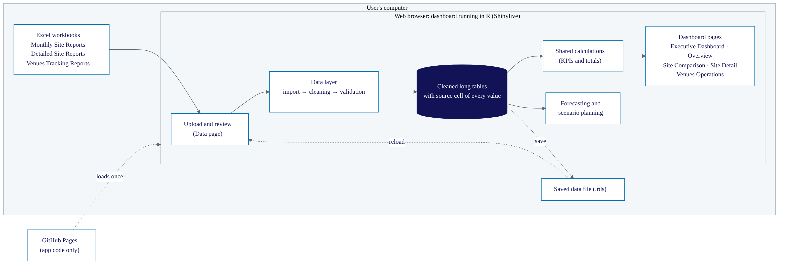

```{r}
#| label: setup
#| include: false
cited <- c(
  "base", "shiny", "bslib", "bsicons", "htmltools", "readxl", "writexl",
  "renv", "knitr"
)
cited <- cited[vapply(cited, requireNamespace, logical(1), quietly = TRUE)]
knitr::write_bib(cited, file = "references/packages.bib")
```

# Abstract {.unnumbered}

<!--Owner: Vicky -->

# Introduction {#sec-intro}

Monash Sport runs sport and recreation at Monash University. It operates health and fitness centres on the Clayton, Caulfield and Peninsula campuses, along with aquatic programs, court and facility hire, group fitness, social sport and the university's sporting clubs. In 2024 it recorded more than 1.2 million visits, 10,438 fitness and aquatics members, 35 sporting clubs with 5,587 members and around 100,000 hours of court hire [@monash2025plan]. The university's *Sport and Physical Activity Plan 2025--2030* also commits to "data-informed approaches" when deciding where to put effort and investment in programs and facilities, which assumes managers can see clearly how each part of the organisation is doing.

Monash Sport records financial and operational performance in three families of Excel workbooks: Monthly Site Reports, Detailed Site Reports and Venues Tracking Reports. The available reports for 2021 to 2025 comprise 38 workbooks. Management uses them to review monthly and annual changes in internal meetings and to report to university management.

According to Monash Sport staff, the current format has been in use for at least ten years. It has grown one file at a time, and how the workbooks relate to each other is not clearly documented. To compare one site's income with last year, or with another site, someone has to open several files and line up the rows by hand. Layouts change from year to year, and summary rows sit next to the detail rows they total, so trends are hard to follow across files. The workbooks are also difficult to show in a meeting. A dashboard puts the most important figures on one screen so they can be read at a glance [@few2006; @sarikaya2019], and this is what Monash Sport asked for. Finally, the reports only look back: they cannot show what the coming months might look like if wages or prices change.

This project, carried out with Monash Sport for the ETC5543 Business Analytics Creative Activity, built an interactive R Shiny dashboard. Staff upload the report workbooks as they are. The dashboard checks their structure and totals, turns them into consistent tables in which every value can be traced back to its Excel cell, and shows financial and operational results for the whole organisation, each site and each facility. A forecasting page uses the same data to estimate income and expenses for the next few months under different payroll, price and demand assumptions. Everything runs in the web browser, so the confidential workbooks never leave the user's computer. The dashboard is available at <https://vicky-fengz.github.io/ETC5543-Monash-Sports/>.


# Objectives and significance {#sec-objectives}

The project aims to give Monash Sport a dashboard it can keep using after the project ends. Staff need to be able to read it easily and trust its figures, and it has to keep working as new reports arrive each year. To meet the objectives below, the project built an R Shiny dashboard on an import pipeline that reads and validates the three report families, added a forecasting tool based on simple benchmark models, and evaluated both with automated tests on synthetic workbooks and on the 38 real workbooks for 2021 to 2025.

## Data objectives {#sec-obj-data}

The figures on the dashboard need to be accurate and consistent. They should agree with Monash Sport's own reports, and a measure such as income or visits should mean the same thing for every site and every year, even though the reports were never designed to be read together.

Users also need a reason to trust what they see. If someone questions a figure in a meeting, it should be possible to trace where it came from. If a report contains something unexpected, users should be warned when they load it, before the figure reaches a chart.

The data side also has to be reusable. Monash Sport will keep producing reports in its current format, so next year's reports should load without a developer changing the dashboard. Other people should also be able to reproduce and check the work without seeing the confidential data.

## Dashboard objectives {#sec-obj-dashboard}

<!--Owner: Ayush-->

## Forecasting objectives {#sec-obj-forecast}

The forecasting tool should give management a realistic picture of the coming months, based on what has happened in the past. The people using it are not forecasting specialists, so the method should be easy to explain, and the forecast should show how uncertain it is.

It should also let management test a decision before making it. Questions such as "what if casual pay rates rise?" or "what if prices go up and demand falls?" should be answerable on the page, with the assumptions behind each answer kept in view so the plan can be explained to others.

## Significance {#sec-significance}

The dashboard brings comparisons that previously required several workbooks into a single interface. Staff will still compile the workbooks each month, but can then compare sites and years using a consistent set of figures. This supports the university plan's commitment to data-informed decisions [@monash2025plan]. The forecasting tool extends this reporting workflow to planning under alternative cost and price assumptions.

The approach is also unusual in working with the existing workbooks as they are. It needs no database or server, keeps the confidential reports on the user's own computer, and links every figure on the dashboard back to its source cell. The code is published with synthetic versions of the workbooks, so others can run, check and adapt the work without access to the real data.

# System design {#sec-design}

## Users and requirements {#sec-users}

The dashboard is built for Monash Sport's management team. Managers work with Excel reports every month but do not use R or other programming languages, so they need an interface that requires no software installation or coding. In meetings with the project team, the mentors set two firm requirements: confidential reports must not be sent outside Monash Sport, and monthly and annual results must be brought together for presentation in meetings. The remaining requirements reflect the existing Excel workflow and the need for staff to use the dashboard independently after handover (@tbl-requirements).

| Requirement | Source | Design response |
|---|---|---|
| Confidential reports must stay within Monash Sport | Mentors | The dashboard runs in the user's own browser, and reports are uploaded from the user's computer |
| Monthly and annual results shown together for meetings | Mentors | Organisation-level pages and a one-page Presentation View |
| No programming or new tools for users | Users' skills | Opened from a web link; all actions use buttons and menus |
| Reports read in their current format | Existing practice | Importers built around the existing workbook layouts |
| Keeps working in future years | Existing practice | New report years load without code changes; Excel templates |

: Requirements for the dashboard and how the design responds to them. {#tbl-requirements}

## Architecture {#sec-architecture}

@fig-architecture shows the data flow. GitHub Pages supplies the application code, which runs as R in the user's browser through Shinylive [@R-shinylive] and webR. The Data page passes uploaded workbooks to the data layer for import, cleaning and validation. All pages, including Forecasting, use the resulting long tables through shared calculations. Cleaned data can also be saved locally and reloaded in a later session (@sec-upload).

{#fig-architecture}

The code is organised the same way. Each report family has its own import, cleaning and validation scripts under `R/data/`, each page is a separate Shiny module (`R/mod_*.R`) [@wickham2021], and the calculations and charts used by several pages live in shared files. Pages depend only on the cleaned tables and not on each other, so one page can be changed, or a new one added, without editing the others.

The dashboard is written in R [@R-base]. The interface is built with shiny [@R-shiny], bslib [@R-bslib], bsicons [@R-bsicons] and htmltools [@R-htmltools]. Workbooks are read with readxl [@R-readxl] and cleaned tables are exported to Excel with writexl [@R-writexl]. All charts are drawn with base R graphics, and the forecasting models use the stats package that comes with R. The browser version is built with shinylive, and the package versions used are recorded with renv [@R-renv] so that the environment can be reproduced. This report was written in Quarto [@quarto] with knitr [@R-knitr].

## Design principles {#sec-principles}

The team chose R Shiny over business intelligence tools such as Power BI or Tableau mainly for flexibility. The workbooks have irregular layouts that change between years, and reading them correctly takes custom parsing and validation code that is easier to write and test in a programming language. R also keeps the data processing, the dashboard and the forecasting models in one code base. Staff access the app through a web link, without installing R or managing a software licence.

Browser execution meets the privacy requirement without requiring users to install R. In a conventional server-hosted Shiny deployment, uploaded reports would be processed on the server. Shinylive keeps that processing on the user's computer, at the cost of slower execution than desktop R. Import optimisation and explicit saving of cleaned data address that trade-off (@sec-eval-performance). File upload was also the practical choice because the project team had no access to Monash Sport's finance or booking systems, and it leaves users in control of the source workbooks.

The pages were initially organised around the three report families, with Overview for the Monthly Site Reports, Site Comparison, and a single Detailed Analysis page. After working through the workbooks, the team split Detailed Analysis into Site Detail and Venues Operations because the Venues Tracking Reports record different measures from the other business units. The Executive Dashboard came from mentor feedback. The mentors found the existing pages detailed, but presenting them in a meeting meant switching between pages and scrolling. The Executive Dashboard and its Presentation View put the selected figures and charts on one screen.

The visual design follows the Monash brand guidelines [@monashbrand]. Key figures and the main chart series use Monash blue. Navigation and highlights use the brighter tertiary blues, which give the dashboard a livelier look suited to a sport organisation and distinguish it from the main university website. Every chart uses orange, a brand colour for data visualisation, as its second colour, so two series being compared are easy to tell apart. The layout is designed for laptops and projected screens, where the dashboard will be used, and also adapts to narrower windows.

## Documentation and handover {#sec-handover}

Because Monash Sport staff will use and maintain the dashboard without the project team, the project includes documentation for each audience. A step-by-step user guide, written for staff with no coding experience, covers loading the reports, each page, forecasting and the messages the dashboard can show. It is published as a web page and a PDF and is linked from the dashboard's navigation bar. A separate maintainer guide explains how to run the dashboard in RStudio, test changes against the real reports and publish a new version, and a data dictionary documents every cleaned table and column (@tbl-appendix-tables). Blank Excel templates with guide sheets help staff prepare reports that the importers can read (@sec-extend).

# Data pipeline: from workbooks to tidy tables {#sec-data}

## Source reports {#sec-sources}

Monthly Site Reports record each site's monthly Income and Expenses, with Actual results alongside the Budget planned for the year, and combine them into an organisation total. Each workbook has nine worksheets: a finance summary for the whole organisation, one sheet for each site, and a dashboard sheet with charts.

Detailed Site Reports are completed annually by Aquatics, Caulfield, Health & Fitness, Participation Program, Peninsula and Venues. They break financial results down by facility and program and add visits, memberships and enrolments. Each workbook has between five and eighteen worksheets, depending on the business unit. The Caulfield and Peninsula reports, for example, include a separate sheet for every month.

Venues, the unit responsible for courts and facility hire, also maintains a separate Venues Tracking Report. Its sixteen worksheets cover finance, casual hours and wages, attendance, bookings, facility and court hire, memberships, online sales and merchandise, alongside operational logs such as cancellation reasons and service desk calls.

Much of the early work went into reading these sheets one by one and deciding what to import. Two questions guided the choice. Does the information describe how Monash Sport is performing, and is it recorded in the same way every month and every year, so that it can be compared over time and across sites? The financial results and the main operational measures, such as visits, memberships, enrolments, facility hire and casual wages, pass both tests and are imported. Free-text sheets such as monthly highlights and help notes are left out because they cannot be summed or compared. The charts already drawn in the workbooks repeat numbers that are imported anyway, and operational logs such as cancellation reasons do not feed any performance measure. Leaving them out also keeps the dashboard to what management asked to see.

The workbooks also differ from each other in many small ways, and the differences change from year to year. Worksheets appear in a different order, are added in some years, or carry the year in their name (for example, `2025 Casual Hours`). Sheet names and labels sometimes have extra spaces, abbreviations or spelling variations, and months are stored as text in some sheets and as Excel dates or numbers in others. Summary rows and totals sit beside the detail rows they add up, and months that have not been reported yet are often filled with zeros. A person reading one workbook hardly notices these differences, but a program cannot assume that a value will always be in the same cell.

The data also have limitations that shape what the dashboard can show. The workbooks are summary reports: they record monthly totals by site, facility and program, but no individual transactions, bookings or customers, so the dashboard cannot analyse behaviour below that level or estimate how customers respond to price changes. The history is short, covering 2021 to 2025 at monthly frequency, and the Venues Tracking Reports start only in 2022. Casual salaries in the Venues Tracking Reports are the only wage data available, and it is not known whether they cover every casual employee. Some workbooks also contain missing months or totals that do not match their components, which the dashboard reports rather than corrects (@sec-cleaning).

The reports are confidential and are not included in the project repository. All figures and examples in this report use synthetic workbooks that copy the layout of the originals but contain randomly generated numbers.

## Import, cleaning and validation {#sec-cleaning}

Each report family is processed in three steps. The import stage finds the required worksheets by name and reads their cells. Cleaning locates data blocks through labels such as the month names and the `INCOME` and `EXPENSES` headings, then reshapes them into long tables. Validation checks the resulting structure and totals against the rules for that report family.

Label searches accommodate the layout changes described in @sec-sources. A fixed reference such as "income for January is in cell B7" breaks when someone inserts a row, whereas the headings can still identify the block. Separate scripts allow changes to one family's importer to be tested independently and help distinguish file-reading, reshaping and validation errors.

The cleaned data use a long, or tidy, format [@wickham2014], with one row for each value and columns describing its site or business unit, measure, Actual or Budget status, month and value (@fig-before-after). Retaining the workbooks' wide layouts would have required separate processing for each report and page. The common structure supports filtering, grouping and plotting across report families, and a new month or site adds rows rather than columns.

Each row also records the file, worksheet, row and column of its source cell. These references support the mentors' meeting workflow: a questioned figure can be traced back to the workbook. They also helped locate importer errors during development. The tables and their columns are listed in the appendix (@tbl-appendix-columns and @tbl-appendix-tables).

{#fig-before-after}

Cleaning standardises labels so that a facility or membership type spelled two ways is counted as one item across years. Months that have not yet been reported are retained but marked as unreported. This preserves the gap in reporting without treating zero placeholders as actual results that would pull down trends and year-to-date averages.

When a workbook reports a year-to-date or facility total, the cleaned data retain that official figure. Independent recalculations are used for validation rather than to replace it, and totals are kept separate from their components to avoid double counting. Variance columns are not imported because they can be calculated from Budget and Actual; storing them would create a second version of the same measure that could disagree with the calculated value. Each measure also has a unit and an aggregation rule in a configuration file, so rates and averages are not added together.

Validation distinguishes errors that prevent reliable import from warnings that require review. Errors block files with incompatible structures, conflicting report identities or overlapping coverage. Warnings flag incomplete data and reconciliation differences without automatically changing the reported values.

Checks operate within and across workbooks (@tbl-validation). Within a workbook, they examine required sections, months and totals. Across files, they identify overlapping report years and gaps that could otherwise make a trend appear continuous.

| Check | Example | Level | Reason |
|---|---|---|---|
| Structure | A workbook without the `INCOME` and `EXPENSES` sections, or a file that is not a recognised report | Error | Importing it could put wrong or mislabelled figures on the dashboard |
| Completeness | A month missing from a sheet, or a year missing from the series of reports | Warning | Available figures can still be inspected, but coverage is incomplete |
| Reconciliation | A reported total that differs from the sum of its components | Warning | The reported figure is kept, and staff are told where to check the source workbook |
| Across files | Two reports for the same year, or a file name whose year differs from the year inside the workbook | Error | Using the file would count figures twice or assign them to the wrong year |

: Main validation checks, the level at which each is reported, and why. {#tbl-validation}

For example, Total Revenue in the Monthly Site Reports is checked against Actual Income plus revenue opportunity, the income given up through student, staff and other discounts. A mismatch produces a warning with the source location. The reported figure is retained for staff review because the importer cannot determine which source value should change.

## Upload workflow {#sec-upload}

The upload workflow went through several versions. The first draft of the app read the workbooks from a fixed project folder, which does not work in the browser, where the dashboard can only read files the user chooses. The first upload design used a single box for all three report types, but each family has its own importer, and a workbook sent to the wrong importer failed in ways that were hard to trace. The page was therefore split into three boxes, one per report family, so that each error could be tied to a single file and importer.

The three boxes were reliable but left users to sort the workbooks by family. A later rewrite of the upload logic recognises each workbook from its file name, using the same naming rules as the importers, and also made parsing in the browser faster without changing any output (@sec-eval-performance). An option to upload all reports at once was first added alongside the three boxes and, once it had proved reliable, replaced them with a single Add data card. The card accepts individual files, whole folders and saved data files, and asks for a report type only when a file name cannot be recognised.

Files are then processed one at a time, and each one gets a status (queued, parsing, ready or failed) with its warnings or error message beside it. If an updated version of a file fails to load, the previous version stays in use. The View Cleaned Data tab shows the cleaned tables with filters and search and exports them to Excel, so users can check the dashboard's figures against their own reports.

A workbook with an unrecognised file name waits for the user to choose its report type or dismiss it. If the choice does not fit the workbook, the dashboard explains the mismatch. Non-report files, including Excel's temporary lock files and unrelated documents, are ignored. A summary distinguishes files that were matched, skipped, left for classification or ignored.

Files already loaded with the same name and contents are skipped, avoiding repeated parsing when a folder is selected again. Cross-file checks (@tbl-validation) and the blank-template check stop files that would double count or mislabel figures, or contain no figures. The upload controls pause during parsing because overlapping uploads fail in the browser version.

Browser performance also made it important to avoid reparsing the workbooks in every session. The first plan was for the dashboard to download the imported data automatically after each upload, so that users would not have to remember to save it. This proved hard to make reliable under Shinylive, and it would have written confidential figures to the user's computer without the user choosing to do so or deciding where they were stored, which is a particular risk on shared computers. The final design keeps saving as an explicit step: users click Save current data to download the cleaned tables as a single `.rds` file and store it with their reports. Downloads themselves needed extra work in the browser version. Shinylive serves a download from the R session running in the page, but an ordinary download link opens a separate request that cannot reach that session, so the browser saved a broken file instead. A small JavaScript helper fetches the file from within the page and saves it from memory, which makes saving the cleaned data, exporting tables to Excel and downloading forecast plans work in the browser. An automated test checks the helper's file names, file contents, error messages and repeated clicks.

Loading this file restores the cleaned data without reading the workbooks again. It records which reports it contains and when it was saved, and the dashboard warns users when it is more than 30 days old. A saved file can also be selected together with workbooks. It is loaded first, and changed workbooks replace matching saved copies after successful import and validation. Damaged saved files, or files from an older version whose tables have a different structure, are refused with a message, and the current session is left unchanged.

## Extending to future years {#sec-extend}

Because the project team will not be available to update the code each year, the importers accept future reporting years within the supported layouts (@sec-cleaning). The report year is read from the file name and checked against the contents. Within these layouts, new columns and categories, such as discount types, facilities or membership groups, pass through to the cleaned tables. Retaining these additions avoids data disappearing unnoticed, and new measures can be described in the configuration file.

Blank templates for each report family include a guide to the required structure and are available on the Data page. They help new staff prepare compatible reports. A substantial redesign of a workbook still requires an update to that family's importer.

# The dashboard {#sec-dashboard}

<!--Owner: Ayush-->


# Forecasting and scenario planning {#sec-forecast}

The pages in @sec-dashboard show what has already happened, but management also has to plan ahead. One decision comes up regularly: when staff pay rates rise, how much do prices need to rise to cover the extra cost? The project's academic mentor, Minh Huynh, suggested adding a forecasting tool. The team first planned to forecast income, expenses and budget, and discussions with Monash Sport then narrowed the focus to this pay and price question. The resulting page produces a baseline forecast of income and expenses that users can adjust for changes in payroll, prices and demand.

## Forecast data preparation {#sec-forecast-data}

The forecast covers Monash Sport as a whole and uses the monthly Actual Income and Expenses recorded in the Monthly Site Reports. The organisation-wide summary is used where it exists, and the site summaries only when it does not, so the same activity is never counted twice. Individual sites are not forecast. The pay and price question concerns the whole organisation, and the casual salaries used in the payroll scenarios are not split by site.

Before a model is fitted, the monthly series is checked and trimmed. A month is used only if it has both Income and Expenses. Missing months split the history, and the model trains on the latest unbroken run of complete months, since the models below assume a continuous monthly series. At least 12 such months are needed, and the page shows a notice when fewer than 24 are available.

Months at the end of the series in which both Income and Expenses are zero are a special case, because in these reports a zero often means "not yet reported". The page lists these months and asks the user whether they are real results, and leaves them out unless the user confirms them. Forecasting stops altogether if Actual records overlap or a monthly total is negative, as either case points to a problem in the source data that should be checked before any plan is made.

## Model selection {#sec-model-selection}

The tool compares a small set of simple models [@hyndman2021]. The naive model forecasts every future month as equal to the last observed month, and the seasonal naive model forecasts each month as equal to the same month one year earlier. When at least 30 continuous months are available, the comparison also includes additive Holt-Winters exponential smoothing [@holt2004; @winters1960], which estimates a level, a trend and a seasonal pattern from the data. With $y_t$ the value in month $t$ and $h$ the number of months ahead, the two simpler forecasts are

$$
\hat{y}_{T+h} = y_T \quad \text{(naive)}, \qquad \hat{y}_{T+h} = y_{T+h-12k} \quad \text{(seasonal naive)},
$$

where $k$ is the smallest whole number of years that places $T+h-12k$ within the observed data.

The team did not use more complex models such as ARIMA or regression. The history is short, often only a few years of monthly data, which is too little to estimate many parameters reliably. The dashboard also runs in the browser through Shinylive, where only some R packages are available and each extra package slows down loading, whereas the chosen models need only the `stats` package that comes with R. Management also needs to understand where a forecast comes from, and "the same as last year" or "the same as last month" is easy to explain in a meeting.

The model is chosen automatically, separately for Income and for Expenses, by rolling-origin evaluation, also called time series cross-validation [@tashman2000; @hyndman2021]. The history is cut at several past months, called origins. At each origin, every candidate model is fitted to the data up to that month and forecasts up to 12 months ahead, and its forecasts are compared with what actually happened. The tool scores the most recent 12 valid origins and selects the model with the lowest root mean squared error (RMSE). Because all models are scored on the same held-out months, the choice of test period does not favour any of them. When the history is too short for this comparison, the seasonal naive model is used as a provisional choice, because the reports show a clear yearly pattern. The selected models are recorded in the downloadable assumptions file.

## Payroll, price and demand scenarios {#sec-scenarios}

The scenario tool adjusts the baseline forecast for changes that the user enters. Quick estimate forecasts the casual salaries recorded in the Venues Tracking Reports, using the same model selection process, and applies the user's percentage pay increase to them. Manual adjustment lets the user enter a net monthly change in expenses directly, for example the cost of new hires minus the savings from a departure.

The page offers both methods because Venues casual salaries are the only wage data in the reports, and staff numbers and hours can change substantially. Quick estimate suits a general rise in casual pay rates. Manual adjustment covers planned changes that past payroll cannot reflect, such as hiring or losing staff. Only one method is active at a time.

The user can also set a price increase, the share of income that can be repriced, a change in demand, and the month from which all changes take effect.

Let $I_t$ and $E_t$ denote baseline Income and Expenses in month $t$, and let $a_t$ be an indicator equal to 1 from the effective month onwards. The pricing and demand inputs are the repriceable income share $q$, demand change $v$ and price increase $p$. Payroll uses predicted casual salaries $W_t$ and pay increase $w$ in Quick estimate, or the monthly amount $d$ in Manual adjustment. The scenario is

$$
\begin{aligned}
\text{Scenario Income}_t &= I_t \,(1 + a_t v)(1 + a_t q p), \\
\text{Scenario Expenses}_t &= E_t + \begin{cases} a_t W_t w & \text{(Quick estimate)} \\ a_t d & \text{(Manual adjustment).} \end{cases}
\end{aligned}
$$

Changes apply once to each affected month and do not compound. To answer the pay and price question directly, the page also calculates the minimum price increase needed for scenario income to cover scenario expenses over the whole plan:

$$
p_{\min} = \max\left(0,\ \frac{\sum_t \text{Scenario Expenses}_t - \sum_t I_t (1 + a_t v)}{q \sum_{t:\,a_t = 1} I_t (1 + a_t v)}\right).
$$

A price-sensitivity chart shows total income at a range of price increases next to total scenario expenses, and the point where the two lines cross is the minimum price increase. The tool does not estimate how customers respond to price changes, because the reports contain no data from which price elasticity could be estimated. The demand change is therefore the user's own assumption, and the page labels it as one.

## Uncertainty and interface {#sec-forecast-ui}

When enough history is available, forecasts are shown with 80% and 95% prediction intervals. For the naive and seasonal naive models, the intervals are based on the spread of past forecast errors and widen with the forecast horizon, as in the income chart in @fig-forecasting. For Holt-Winters, they come from the fitted model. The scenario adjustments shift the intervals in the same way as the forecast, so the intervals reflect uncertainty in the baseline forecast only. They do not cover uncertainty in the payroll forecast or in the user's assumptions about prices, demand and pay, which a note under the charts points out.

A manager needs only a few inputs to build a plan. The main controls (forecast horizon, pay increase or manual amount, and price increase) remain visible, while less common settings, such as the history period and repriceable share, sit under More options. Results combine headline figures with monthly charts and a table. Use this minimum price applies the calculated minimum to the price input, and Reset plan restores the defaults. The monthly plan and its assumptions can be downloaded as CSV files for recording and checking a decision later.

## Worked example {#sec-forecast-example}

@fig-forecasting and @fig-price-sensitivity show an example plan built on the synthetic data. The baseline forecast puts total income for the year at about \$8.5 million against expenses of about \$11.6 million, so the plan already has a shortfall before any change is made. A casual pay increase adds about \$149,000, bringing expenses to \$11.7 million, and covering them requires a minimum price increase of 37.7% on all income. This is far more than the pay increase alone would require, because the price rise also has to close the existing gap. For this reason the page notes that the minimum includes any existing shortfall, and that it covers the plan as a whole, so individual months may still fall short.

{#fig-forecasting}

{#fig-price-sensitivity}

# Evaluation {#sec-evaluation}

<!-- Owner: Both -->

## Approach {#sec-eval-approach}

The system was evaluated against the objectives in @sec-objectives using two kinds of evidence. The first is a set of automated tests, written as R scripts, that run the importers, the calculations and the whole app on the synthetic workbooks and on the real workbooks that Monash Sport provided for 2021 to 2025. The tests on synthetic data run through GitHub Actions every time the code changes. The tests on real data were run locally, because those files cannot leave the project team. The second kind of evidence is timing measurements of the importers and the dashboard, in desktop R and in the browser. The 26 R test scripts are summarised by area in @tbl-tests in the appendix, and a separate JavaScript test checks the download helper described in @sec-upload.

## Accurate and consistent figures {#sec-eval-accuracy}

All 38 real workbooks (4 Monthly Site Reports, 4 Venues Tracking Reports and 30 Detailed Site Reports) were imported without errors. Several tests then check that the cleaned figures are consistent with each other. In each workbook, the monthly totals of the individual sites must add up to the organisation summary, which tests both the reshaping and the rule that reported totals are kept as they are. A further test checks that the Income and Expenses figures are identical on the Overview, the Executive Dashboard, the Site Comparison page and in the forecasting history. Finally, 406 key annual figures from the synthetic workbooks are stored as an accepted snapshot. If a code change alters any of them, the tests fail until someone reviews and accepts the change.

## Validation and traceability {#sec-eval-trust}

Across the 38 real workbooks, validation raised no errors and 278 warnings. Every Monthly Site Report and Venues Tracking Report, and 28 of the 30 Detailed Site Reports, had at least one warning. The importers also ran 20,172 reconciliation checks, each comparing a total reported in a workbook with the sum of its components (@tbl-validation-results). Of these, 89.6% passed and 283 (1.4%) found a difference. Most differences were in visit totals in the Detailed Site Reports (224), and the remaining 59 were spread across merchandise, facility hire, membership, Total Revenue, casual hours, court hire and finance checks. A further 9.0% could not be completed because a component or the reported total was missing, mostly in visit breakdowns that had not been filled in.

| Report family | Workbooks | Warnings | Checks | Passed | Difference found | Could not be completed |
|---|---:|---:|---:|---:|---:|---:|
| Monthly Site Reports | 4 | 8 | 156 | 138 | 6 | 12 |
| Detailed Site Reports | 30 | 208 | 17,095 | 15,191 | 231 | 1,673 |
| Venues Tracking Reports | 4 | 62 | 2,921 | 2,747 | 46 | 128 |
| Total | 38 | 278 | 20,172 | 18,076 | 283 | 1,813 |

: Validation results on the real reports. A check compares a reported total with the sum of its components; counts only, so no figures from the reports are shown. {#tbl-validation-results}

As intended, the dashboard reported each problem as a warning, kept the reported figures and named the file and sheet concerned. The results show that the source reports contain a small but real number of internal inconsistencies, concentrated in the detailed operational sheets, which would be hard to find by reading the workbooks one at a time.

To confirm that the checks catch problems when they occur, one test script deliberately breaks copies of the synthetic workbooks and passes them through the normal import process. Each fault in @tbl-fault-injection produced the expected warning or error.

| Report | Fault introduced | Result |
|---|---|---|
| Monthly Site Report | Total Revenue changed | Warning; finance figures still imported |
| | DISCOUNTS section removed | Warning; finance figures still imported |
| | `INCOME` and `EXPENSES` missing from one site sheet | Warning; only that sheet skipped |
| | Finance summary sheet removed | Warning |
| | No sheet with finance sections | Error; nothing imported |
| | Reports for 2022 and 2024 but not 2023 | Warning naming the missing year |
| Detailed Site Report | January Actual changed in the Finance sheet | Warning: finance check failed |
| | Total Revenue changed | Warning |
| | March missing from the Finance sheet | Warning naming the missing month |
| | DISCOUNTS section removed | Error; file not used |
| | February heading changed to January in Direct Visits | Error: duplicate month; file not used |
| Venues Tracking Report | January Indoor Actual changed | Warning: Venues finance check failed |

: Faults deliberately introduced into copies of the synthetic workbooks, and how validation responded. {#tbl-fault-injection}

The same fault can lead to different results in different report families, following the distinction in @sec-cleaning between errors that prevent reliable import and warnings that need review. A Monthly Site Report reads each site sheet separately, so a missing discount section only removes that sheet's revenue opportunity figures. A Detailed Site Report has a single Finance sheet whose finance, discount and Total Revenue sections always appear together, so a missing section shows that the workbook does not follow the template, and reading it further could place values in the wrong rows. A duplicated month heading is an error for the same reason.

Separate tests run the real importers on problem files: two reports for the same year, a file name whose year differs from the year inside the workbook, a blank template, a damaged file, and a saved data file that overlaps reports already loaded. In every case the file was blocked or handled as designed, and the data already loaded stayed unchanged. Traceability is built into the data structure rather than tested separately: every row of every cleaned table carries its source file, sheet, row and column, and the View Cleaned Data tab shows these alongside each value (@fig-before-after).

## Reusable over time {#sec-eval-reuse}

Several tests imitate supported additions to future reports (@sec-extend). They load a Venues Tracking Report for a future year, with year-named worksheets and new sections, as well as reports with new columns and categories, and check that these pass through cleaning, validation, the cleaned-data preview and the Excel export. Another test checks that the blank Excel templates on the Data page match the structure expected by the importers. The synthetic workbooks and all the tests are published with the code, so anyone can rerun this evaluation without the real data.

## Functional robustness and runtime performance {#sec-eval-performance}

An app-level test starts the dashboard and renders every output on every page with seven combinations of data: no data, one report of each type on its own, one of each type together, the full set of real reports, and the full set loaded from a saved file. Every page rendered without errors, including when some report families were missing.

Profiling the importers guided an optimisation that reads each worksheet's cells once, caches them and builds each table in a single step. @tbl-performance shows the effect on the real reports in desktop R. After each change, the cleaned tables were compared with those from the original version, and the faster importers produced identical results.

| Report family (real data, desktop R) | Before | After | Speed-up |
|---|---|---|---|
| Monthly Site Reports | 30.7 s | 2.3 s | 13 times |
| Venues Tracking Reports | 79.1 s | 13.3 s | 6 times |
| Detailed Site Reports | 189.6 s | 32.5 s | 6 times |

: Time to import each family of real reports in desktop R, before and after the import code was optimised. {#tbl-performance}

In the browser, the published dashboard takes about 16 seconds to load, and reading the full set of real reports takes about 2 minutes 38 seconds. Loading the same data from a saved file takes about 3 seconds. In practice, a user reads the workbooks once when new reports arrive and saves the result. Before a meeting, they open the web page and load the saved file, and the dashboard is ready in about 20 seconds.

## Forecasting {#sec-eval-forecast}

The forecasting tests check scenario calculations against values worked out by hand, including partial-year timing, demand changes, both payroll methods and the minimum price increase at which income exactly covers expenses. They also verify that candidate models use the same test periods in rolling-origin evaluation, that prediction intervals appear only with sufficient history, and that the intervals move with the scenario line.

Tests with gaps, overlapping files, short series, unconfirmed zero months and invalid manual amounts check whether the tool handles each case as described in @sec-forecast-data or stops with a clear message.

## Limits of this evaluation {#sec-limitations}

<!--
Owner: Both. Each limit is its own paragraph, so new ones (e.g. from Ayush's
dashboard evaluation) can be added or removed without rewording the others.
-->

The tests show that the dashboard agrees with Monash Sport's workbooks, but they cannot show whether the workbooks themselves are correct. Validation flags internal inconsistencies, such as a total that differs from its parts, while an error entered consistently in a workbook would pass every check.

Monash Sport staff have not yet used the dashboard in routine work, and no one outside the project team has tested its usability. The design follows the mentors' requirements but still needs feedback from real use.

Forecast accuracy has not yet been evaluated on Monash Sport's real reports. The current tests establish computational correctness, not predictive performance.

The synthetic examples demonstrate how the dashboard behaves, but provide no evidence about Monash Sport's actual financial or operational performance.

# Discussion and conclusion {#sec-conclusion}

<!--Owner: Ayush-->

# Use of generative AI {.unnumbered}

<!-- Owner: Both -->
## Ayush

## Vicky

I used Claude to support parts of this project. The assistance mainly involved improving the data extraction logic, checking edge cases in the file upload process, and fixing bugs. I also used AI to refine the CSS styling of the dashboard and website, add tests for boundary conditions, and improve the grammar, clarity and flow of my report and project documentation.

I treated the AI’s suggestions as guidance and made the final design and implementation decisions myself. I reviewed and adjusted the suggested code, checked the outputs and test results, and assessed whether the changes were appropriate for the project before including them. I also reviewed the revised writing to ensure that it accurately reflected the work completed.

# References {.unnumbered}

::: {#refs}
:::



# Appendix {.appendix .unnumbered}

## Cleaned data tables {.unnumbered}

The data layer turns each report family into a set of long tables with one row per value. @tbl-appendix-columns lists the columns that most tables share, and @tbl-appendix-tables lists the tables for each report family. The complete data dictionary, with every column and its type, is in `docs/data_dictionary.md` in the project repository.

| Column | Meaning |
|---|---|
| `report_year` | Reporting year of the source workbook, taken from its file name |
| `date`, `month`, `month_label` | The month the value belongs to; empty for year-to-date and total rows |
| `period_type` | `Month`, `YTD` (a year-to-date value reported in the workbook) or `Reported Total` |
| `row_type` | The kind of row in the source layout, such as a detail line, a section total or an overall total |
| `metric` | What the value measures, such as `Income`, `Paid Hours` or `New Members` |
| `value` | The number itself |
| `is_reported` | `FALSE` for months filled with zeros that have not yet been reported, which are left out of KPIs and trends |
| `source_file`, `source_sheet`, `source_row`, `source_column` | The workbook cell the value came from |

: Columns shared by most cleaned tables. {#tbl-appendix-columns}

```{=typst}
#show figure.where(kind: table): set block(breakable: true)
#show table: set text(size: 9pt)
#show table: set par(justify: false)
```

| Report family | Table | Contents | Main identifying columns | Used by |
|---|---|---|---|---|
| Monthly Site Reports | `finance` | Monthly income and expenses | `site`, `site_code`, `business_unit`, `is_summary`, `value_type` (Actual or Budget) | Executive Dashboard, Overview, Site Comparison, Forecasting |
| | `discounts` | Discounts given, by type | as `finance`, with `discount_type` | Executive Dashboard, Overview, Site Comparison |
| | `total_revenue` | Annual reconciliation of actual income, discounts and reported Total Revenue | `site`, calculated and reported totals, `validation_status` | Executive Dashboard, Overview, Site Comparison |
| Detailed Site Reports | `finance`, `discounts`, `total_revenue` | As for the Monthly Site Reports, by facility or program | `report_unit`, `campus`, `fund_code` | Site Comparison, Site Detail |
| | `visits` | Direct and indirect visits | `visit_type`, `activity`, `audience` | Site Detail |
| | `memberships`, `enrollments` | Membership and program enrolment counts and targets | `dataset_type`, `metric`, `metric_type` | Site Detail |
| Venues Tracking Reports | `finance` | Monthly income and expenses by fund | `fund`, `row_type`, `value_type` | Venues Operations |
| | `attendance` | Attendance by area and activity | `area`, `activity`, `category` | Venues Operations |
| | `facility_hire`, `court_hire` | Hire revenue and transactions | `facility` or `court_type`, `category` | Venues Operations |
| | `membership` | Membership products and movements | `membership_group`, `membership_type` | Venues Operations |
| | `online_sales`, `merchandise` | Online and merchandise sales | `site`, `category`, `section`, `item` | Venues Operations |
| | `casual_hours`, `casual_wages` | Budgeted and paid hours; casual salaries | `record_group`, `series`, `salary_year` | Venues Operations, Forecasting |
| All families | `*_checks`, `validation`, `files` | Results of each reconciliation check, import warnings and errors, and a summary of each uploaded file | `check_type`, `status`, `level`, source location | Data page |

: Cleaned tables produced for each report family. {#tbl-appendix-tables tbl-colwidths="[15,18,24,26,17]"}

## Automated tests {.unnumbered}

| Area | Scripts | What they check |
|---|---|---|
| Importing and uploading reports | 10 | Cell parsing and worksheet selection, future-year layouts, new columns and categories, the Excel templates, the upload workflow and its warnings, saved-data checks, problem files, deliberately broken workbooks, and every real workbook |
| Dashboard pages | 8 | Shared report years and site lists, the figures and charts on each page, behaviour with partial data, and every chart at wide and narrow sizes |
| Forecasting | 5 | Models, backtests, prediction intervals, scenarios, manual adjustments, safeguards, downloads and page layout |
| Whole app and key figures | 3 | Rendering every page with seven combinations of data, consistency across pages, and key figures against an accepted snapshot |

: Automated test scripts by area. The scripts and what each one checks are listed in `tests/README.md` in the project repository. {#tbl-tests}
